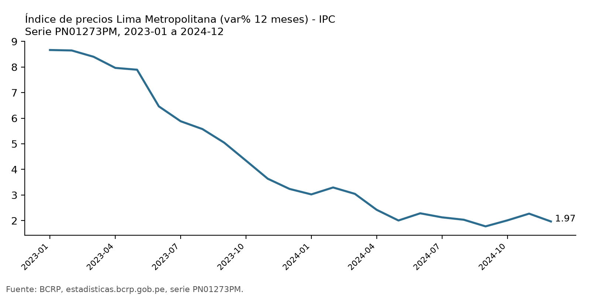
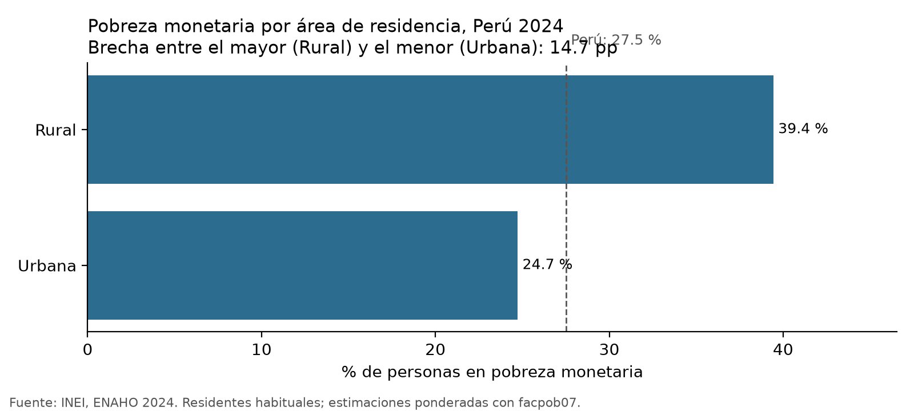
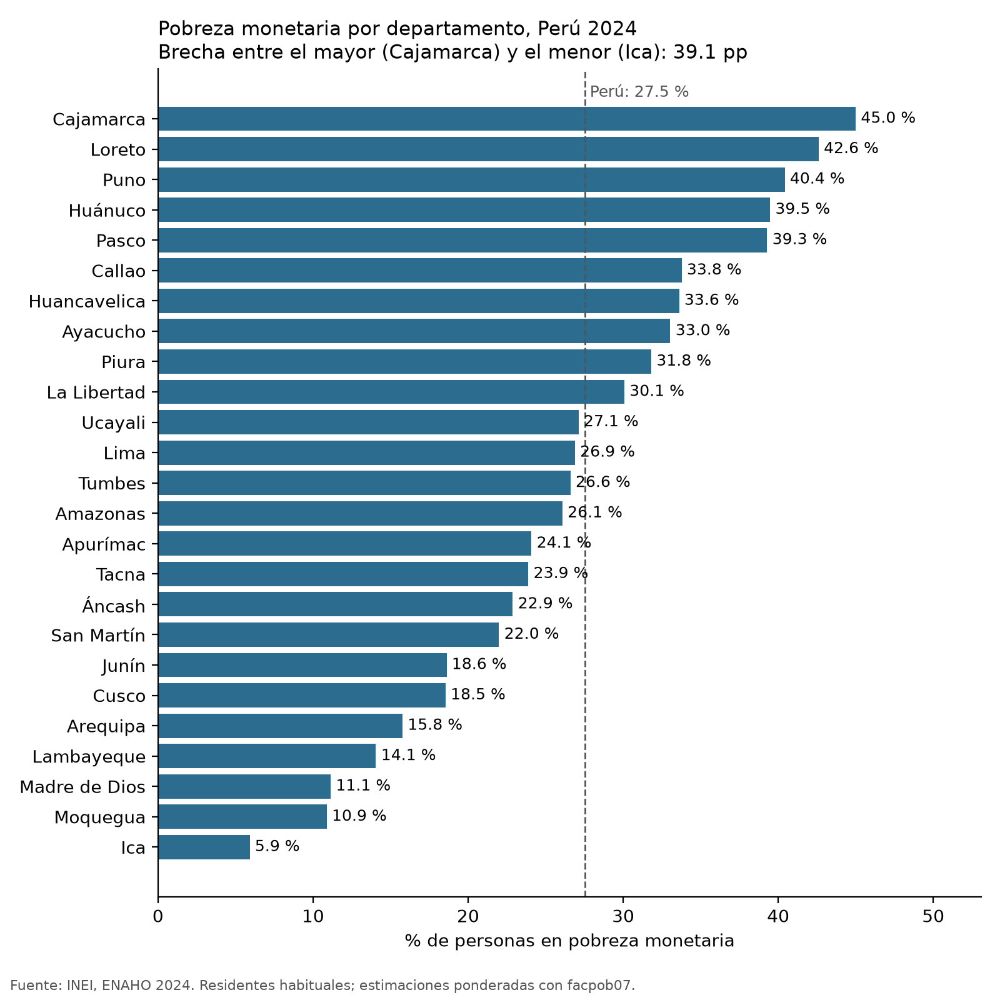
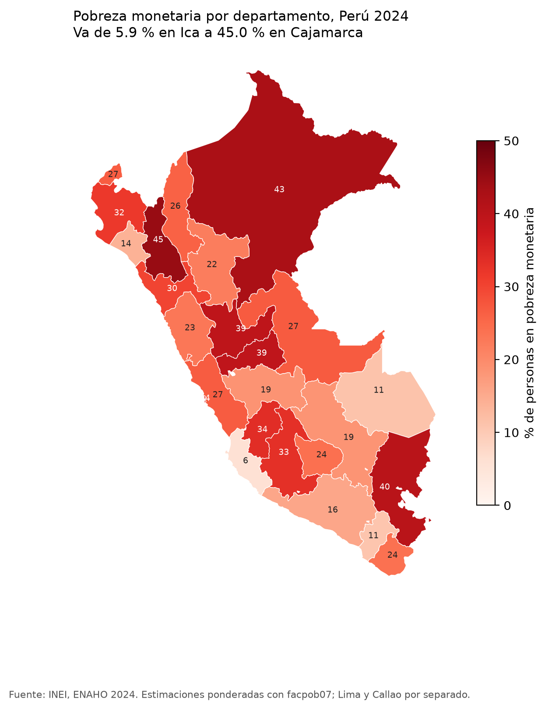

# Precios, política monetaria y pobreza monetaria en el Perú, 2024

## 1. Pregunta de investigación

**Tema:** contexto de precios y de política monetaria del Perú en 2024 (BCRP) y distribución de la pobreza monetaria por área y departamento (ENAHO 2024, INEI).

**Objetivo:** describir (a) la inflación a 12 meses de Lima Metropolitana y la tasa de referencia durante 2024, y (b) la pobreza monetaria por área urbana/rural y por departamento.

**Delimitación:** Perú, año 2024, pobreza monetaria. Es un estudio descriptivo; **no se afirma causalidad** entre inflación, política monetaria y pobreza.

## 2. Fuentes y metodología

- **BCRP (servidor MCP `bcrp`):**
  - `PN01273PM`: IPC Lima Metropolitana, variación % 12 meses (mensual).
  - `PD04722MM`: Tasa de Referencia de la Política Monetaria (mensual).
  - Se usó `PD04722MM`, la versión mensual, para que ambas series tengan la misma frecuencia.
- **INEI, ENAHO 2024 (código 966):** módulo 34 (sumaria) y módulo 02 (miembros del hogar).
- **Filtro:** residentes habituales, `((p204==1)&(p205==2)) | ((p204==2)&(p206==1))`. Quedan 108,664 personas.
- **Ponderación:** todas las cifras de personas usan `facpob07`.
- **Uniones:**
  - Personas con sumaria por `conglome`, `vivienda`, `hogar` (`validate="m:1"`).
  - Mapa: `ubigeo[:2]` con `FIRST_IDDP` del GeoJSON departamental (`validate="1:1"`).
- **Definiciones:** pobre = `pobreza <= 2`; urbano = `estrato <= 5`.
- Las 11 validaciones de `salidas/validacion.txt` salieron APROBADAS.

## 3. Resultados

1. **Inflación a la baja (BCRP, `PN01273PM`, 2024-01 a 2024-12).** Pasó de 3.02 % en enero a 1.97 % en diciembre. El máximo fue 3.29 % (febrero), el mínimo 1.78 % (setiembre) y el promedio 2.36 %.
2. **Recorte de la tasa de referencia (BCRP, `PD04722MM`, 2024).** Bajó de 6.50 % en enero a 5.00 % en diciembre (−1.5 pp). El mínimo, 5.00 %, se alcanzó en noviembre; el promedio fue 5.69 %.
3. **Pobreza nacional (ENAHO, `salidas/validacion.txt`).** 27.53 % de las personas, ponderado con `facpob07`, sobre una población expandida de 34,147,768. Sin ponderar daría 25.61 %, que no es válido.
4. **Brecha urbano-rural (ENAHO, `salidas/validacion.txt`, `figuras/pobreza_area.png`).** Urbana 24.7 % y rural 39.4 %, una brecha de unos 14.7 pp.
5. **Departamentos (ENAHO, `salidas/comparacion_mapa.csv`).** Los más pobres son Cajamarca (45.0 %), Loreto (42.6 %), Puno (40.4 %) y Huánuco (39.5 %). Los menos pobres son Ica (5.9 %), Moquegua (10.9 %) y Madre de Dios (11.1 %). La brecha entre extremos es de 39.1 pp.

## 4. Visualizaciones









## 5. Interpretación

- En 2024 la inflación de Lima Metropolitana se desaceleró y terminó en 1.97 %, cerca del centro del rango de 1 % a 3 %. Es la meta del BCRP, pero no se consultó en esta ejecución. En ese mismo periodo el BCRP redujo su tasa de referencia en 1.5 pp.
- La pobreza se concentra en el ámbito rural y en departamentos de la sierra y la selva norte (Cajamarca, Loreto, Puno, Huánuco, Pasco). La costa sur (Ica, Moquegua) y Madre de Dios muestran los niveles más bajos.
- Lima (26.9 %) está cerca del promedio nacional, y el Callao (33.8 %) queda claramente por encima.
- **Estos patrones son descriptivos.** La inflación es una serie mensual de Lima y la pobreza es un corte anual nacional. Con estos datos no se puede afirmar que la inflación o la política monetaria expliquen la pobreza.

## 6. Verificación de cifras

| Afirmación | Valor calculado | Fuente o procedimiento | Referencia oficial | ¿Coincide? | Diferencia |
|---|---|---|---|---|---|
| Inflación 12m dic-2024 | 1.97 % | MCP `resumen` `PN01273PM` | No se dispuso de otra referencia independiente; es la misma fuente BCRP | No verificable de forma independiente | n/d |
| Tasa de referencia dic-2024 | 5.00 % | MCP `resumen` `PD04722MM` | No se dispuso de otra referencia independiente; es la misma fuente BCRP | No verificable de forma independiente | n/d |
| Pobreza nacional | 27.53 % | `limpiar.py`, ponderado `facpob07` | 27.6 % (INEI) | Sí (tolerancia ±0.1 pp) | −0.07 pp |
| Pobreza urbana | 24.74 % | `limpiar.py`, `estrato <= 5` | 24.8 % (INEI) | Sí | −0.06 pp |
| Pobreza rural | 39.44 % | `limpiar.py`, `estrato >= 6` | 39.3 % (INEI) | Sí (el script la aprobó; desvío mayor que en las otras dos) | +0.14 pp |
| Pobreza departamental (25) | máx. |dif.| = 0.5 pp (Huánuco +0.5, Puno +0.5) | `mapear.py` vs `salidas/comparacion_mapa.csv` | Referencia Sesión 16 | Sí (ninguna supera 0.5 pp) | −0.4 a +0.5 pp |

## 7. Limitaciones

- **Cobertura temporal:** la ENAHO es un corte anual y la inflación es mensual, así que no se pueden cruzar mes a mes.
- **Cobertura geográfica de precios:** la inflación es solo de Lima Metropolitana, no del país.
- **Error muestral:** las estimaciones por departamento tienen márgenes de error que este informe no calcula. Diferencias pequeñas entre departamentos pueden no ser significativas.
- **Referencias BCRP:** no hay una cifra oficial independiente en el pedido para contrastar las series del BCRP.
- **Desvío rural:** el valor rural (39.44 %) se desvía 0.14 pp de la referencia, más que los otros dos indicadores.
- **Errores en esta ejecución:** ninguno. Todas las herramientas y scripts terminaron sin error. La salida de consola de Windows mostró caracteres mal codificados, pero `salidas/validacion.txt` está en UTF-8 correcto.

## 8. Reproducibilidad

```
uv run python "C:/tarea 4/.claude/skills/limpiando-enaho/scripts/limpiar.py" --anio 2024
uv run python "C:/tarea 4/.claude/skills/graficando-enaho/scripts/graficar.py" --por area
uv run python "C:/tarea 4/.claude/skills/graficando-enaho/scripts/graficar.py" --por departamento
uv run python "C:/tarea 4/.claude/skills/mapeando-enaho/scripts/mapear.py"
```

- **Herramientas MCP `bcrp`:** `buscar_series`, `resumen`, `graficar_serie` (`codigo=PN01273PM`, `desde=2023-01`, `hasta=2024-12`).
- **Códigos de serie:** `PN01273PM`, `PD04722MM`.
- **Archivos de salida:**
  - `salidas/validacion.txt`, `salidas/indicadores.csv`, `salidas/personas_2024.parquet`, `salidas/comparacion_mapa.csv`
  - `figuras/bcrp_PN01273PM.png`, `figuras/pobreza_area.png`, `figuras/pobreza_departamento.png`
  - `mapas/pobreza_departamento.png`

Fuente: INEI, ENAHO 2024 (estimación ponderada); BCRP, series estadísticas.
